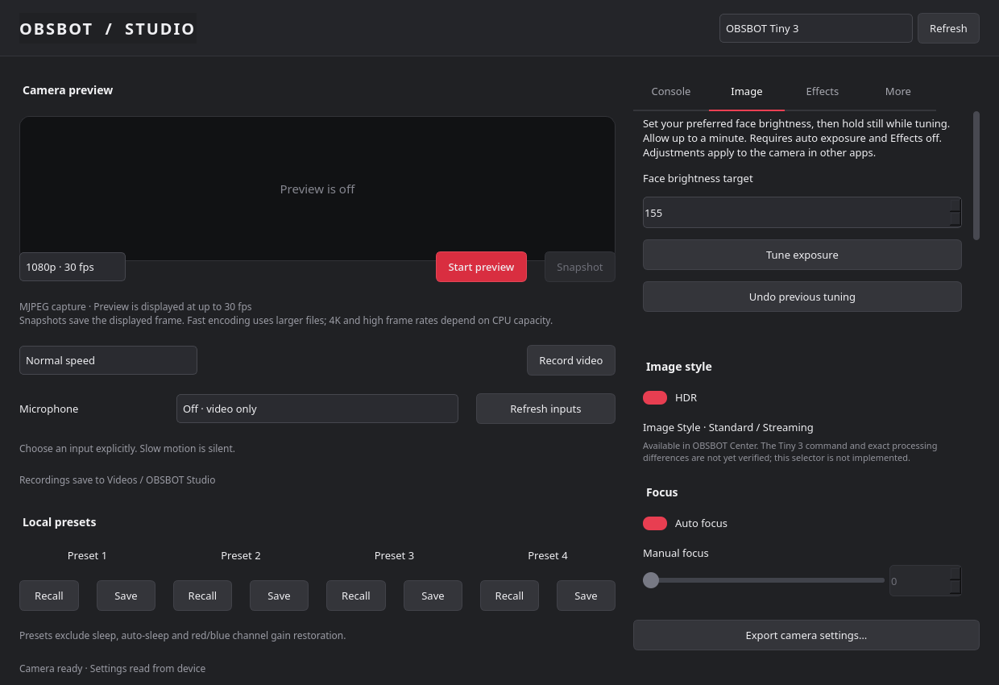

# OBSBOT Studio for Linux

A local PySide6 control panel for the OBSBOT Tiny 3, styled after OBSBOT Center. Uses direct UVC controls and FFmpeg capture. No web server, cloud account, telemetry or proprietary SDK runtime.

This is a working independent app, **not full OBSBOT Center parity**. The [capability reference](docs/RESEARCH.md) lists working controls, controls awaiting hardware verification, and remaining limitations.



## Install on Omarchy / Arch Linux

Tested on Omarchy with Python 3.14, PySide6, OpenCV 5 and FFmpeg. The hardware backend currently supports the **full OBSBOT Tiny 3, USB 3564:ff02**. Tiny 3 Lite and older cameras are not claimed compatible.

Install the system packages first:

```sh
sudo pacman -S --needed python python-pyside6 python-opencv python-numpy opencv ffmpeg v4l-utils
```

Then install the app in a directory you intend to keep:

```sh
git clone https://github.com/johnloringpollard/obsbot-studio.git
cd obsbot-studio
./scripts/setup.sh
```

The setup script creates a local virtual environment and installs PyAV. It adds a launcher in `~/.local/bin` and a desktop entry in `~/.local/share/applications`. Open **OBSBOT Studio** from Omarchy's application menu or run `obsbot-studio`. The launcher points at this checkout; do not move it without rerunning the installer.

This is a desktop app, not an Omarchy shell plugin. It does not modify Hyprland, the bar or system camera services. Other Linux desktops can run it if they supply the same dependencies and camera permissions, but have not been tested. OpenCV 5's TensorFlow Lite importer is required for background effects. Installing an older pip `opencv-python` into the environment will override the supported system OpenCV.

To run without the launcher:

```sh
.venv/bin/python -m obsbot_studio.ui
```

To uninstall the launcher and menu entry, delete `~/.local/bin/obsbot-studio` and `~/.local/share/applications/obsbot-studio.desktop`. Settings remain under `~/.config/obsbot-studio` and `~/.local/state/obsbot-studio`. Photos and recordings remain in your Pictures and Videos folders. This does not replace OBSBOT4Linux.

## Adjust the image

1. Close other camera previews if they hold the device exclusively.
2. Start preview. Select 1080p30 or 4K30 for normal calls, or a higher capture rate for motion.
3. Open **Image**. Adjust HDR, exposure, focus, white balance and color while watching the preview.
4. Stop preview before selecting the camera in another app. Hardware settings remain on the camera.

The app reads existing settings at launch; it does not apply defaults. A private baseline is saved in `~/.local/state/obsbot-studio/`. Export settings creates a readable JSON copy. Four local presets store settings on this computer. Presets exclude sleep/timer and red/blue gain restoration because those gains interact with temperature on this firmware. They are not factory reset or camera hardware PTZ presets.

Single tracking needs a visible person. The camera can return to Off when it cannot acquire a target. Framing controls require active Single mode. Device readback confirms requested mode, not whether a target was acquired.

Auto-sleep writes are disabled after a camera disconnect during testing. Do not enable them by copying protocol examples. Firmware updates and factory reset remain in official OBSBOT Center.

## Capture

Preview displays at up to 1280 pixels wide and 30 fps. Snapshots save that displayed frame in `~/Pictures/OBSBOT Studio/`. Recordings retain the selected capture dimensions and save to `~/Videos/OBSBOT Studio/`. Normal recordings can include a named microphone selected in the app; microphone capture defaults to Off. Slow motion uses a 60/120 fps capture played at 30 fps and remains silent. Recording and preview share one camera stream. Stop recording or close the app to finalize the MP4; wait for completion before disconnecting the camera.

## Verify

```sh
.venv/bin/python scripts/verify.py
```

The normal test command uses mocks and synthetic FFmpeg input. It does not touch the camera. Explicit hardware probes are separate and require permission to change camera settings. Local evidence, sample recordings and screenshots are excluded from version control.

## Local video effects

Use the **Effects** tab for background blur, background images or a solid color, gamma, color filters, and a transparent PNG overlay. Start with low blur strength for a subtle background. The person segmentation model runs locally. Segmentation can make mistakes around hair, hands, and fast motion.

Effects use a separate 720p/30 fps pipeline. Preview, snapshots, and recordings share the processed image. Turn effects off to return to direct 4K or high-frame-rate capture. Settings are fixed while recording. A processing error stops output instead of exposing an unprocessed background.

These effects do not change the USB camera image used directly by a browser or calling app. A dedicated virtual camera is needed for that. The app does not create or take over system loopback devices.

If you installed only the basic controls manually, add the effects runtime with:

```sh
python -m venv --system-site-packages .venv
.venv/bin/python -m pip install -r requirements-effects.txt
python scripts/install_effects_model.py
.venv/bin/python scripts/install.py
```

The virtual environment uses the system PySide6, OpenCV 5, and NumPy packages. The user-local launcher then runs this environment. The model license and checksum are in [models/README.md](models/README.md).

Open **More → Open teleprompter** for a separate scrolling script window. Its text is a reading aid and is not added to the video.

## Tune exposure for the current lighting

Start preview to wake the camera, turn software Effects off, then open **Image → Tune exposure**. Keep one face still in view while the tuner samples the raw camera. It needs automatic exposure and can take up to a minute.

**Face brightness target** defaults to 155 on a 0–255 scale. Raise it for a brighter portrait or lower it for a darker look. This is your visual preference, not a universal skin-tone standard. The tuner aims within seven levels of the target while protecting face highlights.

The tuner tests small exposure-compensation changes first. If those stop helping or reach the allowed adjustment range, it tries a small hardware-brightness change. It measures every candidate, restores rejected changes, and keeps the best measured result. It limits each run to six trials, compensation changes of three steps from the starting value, and brightness changes of six units. It may stop short of your target if further changes are unsafe or ineffective.

**Undo previous tuning** restores the controls saved before the latest accepted tuning. Undo survives app restarts and supports earlier app versions. Failed runs restore all controls they touched. White balance, color gains, HDR, focus and framing remain unchanged.

The tuner runs once; run it again when room lighting changes. The camera's existing auto-exposure continues afterward. Hardware adjustments affect the Tiny 3 when selected in other apps. This is exposure tuning, not calibrated color matching or a guarantee of outperforming another camera.

See [picture quality](docs/PICTURE-QUALITY.md) for comparisons and verification limits.

## Privacy and third-party components

Camera frames and analysis stay on this computer. Runtime camera operation does not call an external service. Setup downloads Python packages and the checksum-pinned Google segmentation model. The model's license and source are included in [models](models/README.md). OpenCV supplies the face detector through the system package. No OBSBOT SDK binary is bundled.

The README screenshot shows the actual interface with preview off. Personal test captures, recordings, camera backups and local environments are excluded from Git.
